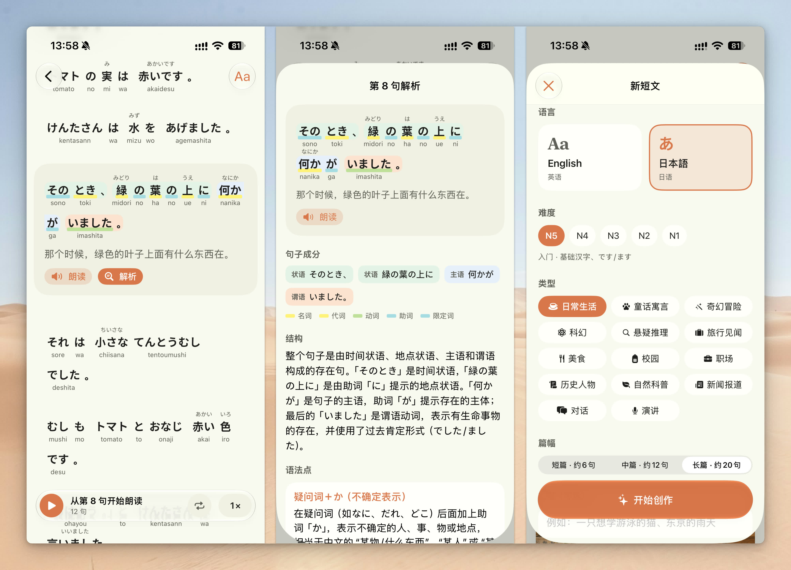

# Fablo

AI-generated reading practice for Chinese speakers learning English or Japanese. Pick a language, level, genre and length, and Fablo writes an original short story at your level, illustrates it, narrates it, and annotates every sentence.



## Features

- **Stories at your level** — English (CEFR A1–C1) or Japanese (JLPT N5–N1), in 15 genres from everyday life and fables to news reports, dialogues and TED-style talks, plus a 句子 set of about 10 standalone sentences pitched slightly above your level (N+1) that avoids sentences you have already practised. Short, medium or long (about 6 / 12 / 20 sentences), with an optional topic.
- **Fresh every time** — new stories are steered away from themes already in your library.
- **Annotated sentences** — each sentence is split into grammatical chunks (subject, predicate, object, …) with per-word part of speech, Chinese gloss, and for Japanese, furigana and romaji. Every sentence has a Chinese translation.
- **Sentence analysis** — tap a sentence for an explanation of its structure, grammar points with new examples, key vocabulary (IPA or kana readings) and nuance notes.
- **Narration** — the whole story is narrated in one pass with word-level highlighting, adjustable speed, pause/resume, looping, and background playback.
- **Cover art** — each story gets a storybook-style illustration.
- **Offline reading** — downloaded stories, sentence analyses, covers and narration are cached on device. Cached content opens first while the app syncs with the server in the background.
- **Reading boards** — switch between 待读, 在读 and 已读 at the bottom of the library. Move stories with the status menu on a card or in the reader. Each board respects the selected language and shows its count; new stories start in 待读. Reading state is saved on the server and shared across devices. Previously synchronized states remain visible offline; changing a state requires a connection.

All explanations are in Simplified Chinese.

## How it works

The iOS app connects to a Bun backend deployed on your VPS, running the API and generation queue in one PM2 service named `fablo`. The backend calls [Vercel AI Gateway](https://vercel.com/ai-gateway):

| Task | Model |
| --- | --- |
| Story generation & sentence analysis (structured JSON output) | `google/gemini-3.8-flash` |
| Cover illustration | `openai/gpt-image-2.5-sunburst` |
| Narration | `google/gemini-3.8-flash-tts` |
| Word timings for highlighting | `microsoft/mai-transcribe-2` |

Stories, analyses and generation jobs are stored on the server in SQLite; covers, narration and word timings are stored alongside it. Adding a story submits a server job, and the app automatically refreshes the library and downloads the results. The server library is the source of all reading content. The app persists disposable copies of downloaded content in its system cache, isolated by server and access token. Library and reader views show cached content before refreshing, and known audio versions play from disk without a status request. Successful synchronization updates resource versions and removes deleted stories and their cached assets. Content that has not been downloaded still needs a connection, and the system may reclaim cache files.

## Project layout

```
Fablo/
  App/        App entry point
  Models/     Observable server records and generated content types
  Services/   Backend API client, disk cache, connection credentials, audio downloads and playback
  Views/      Library, new story, reader, sentence analysis
backend/      Bun API, worker, SQLite storage and PM2 configuration
marketing-video/   Remotion promo video
project.yml        XcodeGen spec
```

## Getting started

Requirements: Xcode with the iOS 26 SDK, and the [Bun backend](backend/README.md) running behind HTTPS.

1. Deploy the backend using the [PM2 deployment instructions](backend/README.md). The Gateway key stays in the server's `.env` file.
2. Open the project and run on an iPhone or simulator:

   ```bash
   open Fablo.xcodeproj
   ```

3. Tap **连接服务** in the app and enter your HTTPS backend address and access token. The token is saved in Keychain. Tap **+** to generate a story on the server; it appears automatically when the text is ready. The server also provides [public reading endpoints](backend/README.md#rest-api) for web clients: stories, cached analyses and media can be read without a token; management and AI generation require authentication.

For on-device builds, change `DEVELOPMENT_TEAM` in `project.yml` (or in Xcode's Signing settings) to your own team. For local simulator development, start the backend with `bun run dev` from `backend/` and connect to `http://localhost:3000`.

If you change `project.yml`, regenerate the Xcode project with [XcodeGen](https://github.com/yonaskolb/XcodeGen):

```bash
xcodegen generate
```

No AI Gateway key is compiled into the app. A legacy `Fablo/Services/Secrets.swift` is excluded from the Xcode target.

## Marketing video

`marketing-video/` is a [Remotion](https://www.remotion.dev) project for the promo video.

```bash
cd marketing-video && npm install && npm run dev
```

Render with `npx remotion render`.
